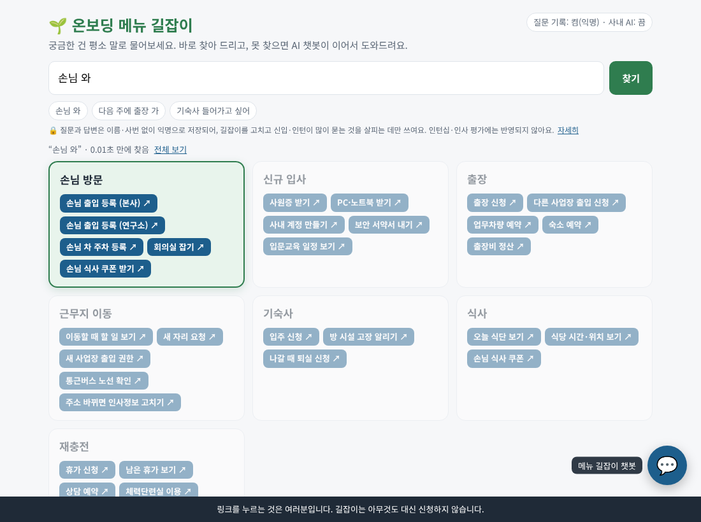
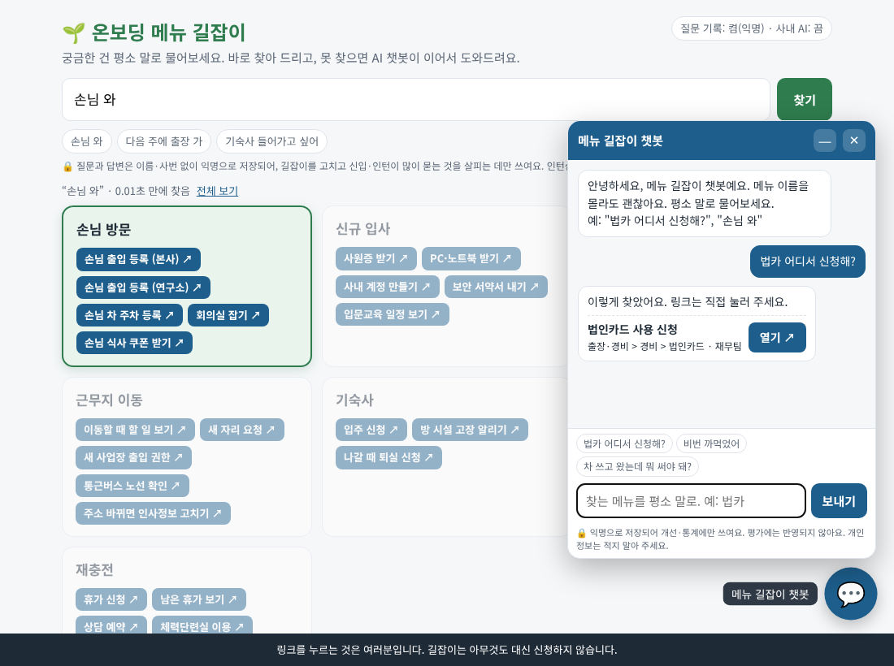

# 🌱 온보딩 메뉴 길잡이 (Onboarding Menu Guide)

> 신입·인턴이 **평소 말로** 물으면("손님 와", "법카 어디서 신청해?") 사내 포털에서 가야 할 메뉴와 할 일 순서를 바로 찾아 주는 도우미.
> **망이 분리된 사무 환경**에서, **회사 데이터를 한 줄도 밖으로 내보내지 않고**, AI 코딩 도구와 함께 만든 HR 실무자의 프로젝트입니다.



> 화면과 데이터는 모두 가짜 회사 **"한빛테크"** 샘플입니다. 실제 조직의 이름·메뉴·주소는 이 저장소에 없습니다.

## 1. 문제
- 사내 포털에는 메뉴 검색창이 이미 있습니다. 하지만 **메뉴 이름을 알아야** 찾을 수 있습니다.
- 신입·인턴은 "차 쓰고 왔는데 뭐 써야 돼?", "손님 와"처럼 묻습니다. 정답 메뉴 이름(차량운행일지, 방문 신청…)을 모르니 선배에게 묻거나 헤맵니다.
- 온보딩 담당자는 **신입이 실제로 무엇을 궁금해하는지** 데이터로 알기 어렵습니다.

## 2. 해결: 3층 구조
| 층 | 하는 일 | AI |
|---|---|---|
| 1층 메뉴 지도 검색 | 질문 → 동의어 펼치기 → 점수 → 상위 3개 메뉴 + 바로 열리는 링크 | 안 씀 (1ms 안쪽, 매번 같은 답) |
| 2층 상황 대시보드 | "손님 방문", "출장" 같은 상황 7개 → 할 일 순서 + 링크 + 담당 부서 | 안 씀 |
| 3층 사내 AI (선택) | 규칙이 못 찾은 질문만, **메뉴 지도 안의 ID만**, **확실할 때만** 고름. 아니면 거절 | 사내 AI (OpenAI 호환 API) |

- 모를 때는 지어내지 않고 **"부서 선배님께 편하게 여쭤보는 건 어떨까요?"**처럼 사람과의 대화로 이어 줍니다.
- **익명 질의응답 기록**으로 못 찾은 질문·많이 묻는 주제를 모아 지도와 온보딩 자료를 고칩니다(`log_report.py`).



## 3. 안전하게 만든 방법 (이 프로젝트의 핵심)
| 원칙 | 구현 |
|---|---|
| **엔진은 밖, 데이터는 안** | 저장소에는 코드 + 가짜 샘플만. 실제 데이터는 실행 PC의 `data/`·`config.py`·`.env`에만(`.gitignore`) |
| **코드는 한 방향으로만** | 저장소 → 사내 실행 PC. 실행 PC의 오류는 사람이 말로 요약해 전달하고, 코드·데이터를 밖으로 가져오지 않음 |
| **실제 데이터 정리는 사내 AI로** | 메뉴 지도는 실행 PC 안에서 사내 AI + 엑셀로 작성([`docs/MAP_PROMPT.md`](docs/MAP_PROMPT.md), 원칙 12가지). 외부 AI는 코치 역할만 |
| **AI 환각 차단** | AI에게 지도 목록을 주고 ID만 고르게 함 → 받은 ID를 지도에서 다시 확인, 없는 ID는 버림. `sure=false`면 거절 |
| **읽기 전용** | 로그인·자동 신청 없음. 링크를 누르는 것은 사람 |
| **개인정보 없는 기록** | 사번·이름·IP·세션 없음, 질문과 클릭을 잇지 않음, 긴 숫자·전화·메일 자동 가림, 5건 이상 묶음 통계만, 90일 뒤 삭제, 화면에 "평가 미반영" 안내 |
| **설치 없는 배포** | 파이썬 표준 라이브러리 + HTML 파일 하나. 외부 CDN·글꼴 없음 → 인터넷 없는 PC에서도 동작 |
| **AI 코딩 가드레일** | AI 코딩 도구가 매 세션 지킨 규칙을 [`CLAUDE.md`](CLAUDE.md)에 명시(회사 정보 금지, 비밀값 커밋 금지 등) |

## 4. 결과 (가짜 데이터 기준)
정답셋 28문항을 "기존 메뉴 검색(흉내)"과 비교했습니다. `python eval.py`

| 질문 종류 | 문항 | 기존 검색 | 길잡이 |
|---|---|---|---|
| 일상어 ("손님 와") | 15 | 3/15 | **15/15** |
| 메뉴 이름 ("통근버스") | 10 | 10/10 | 10/10 |
| 범위 밖 (거절해야 정답) | 3 | 0/3 | **3/3** |

- 메뉴 이름을 아는 사람에게는 기존 검색으로 충분하고, **일상어 질문에서 차이가 납니다.** 이기는 곳과 비기는 곳을 나눠 정직하게 잽니다.
- ⚠️ 가짜 데이터는 정답에 맞춰 만들었으므로 점수가 높게 나옵니다. 실제 성능은 실제 질문·데이터로 다시 재야 합니다.

## 5. 직접 실행해 보기 (설치할 것 없음, Python 3.11·3.13에서 확인)
```bash
git clone https://github.com/retep615615-hub/onboarding-menu-guide-portfolio
cd onboarding-menu-guide-portfolio
python check_data.py      # 데이터 검사 → "문제 없음"
python eval.py            # 정답셋 채점
python app.py             # 브라우저에서 http://127.0.0.1:8000
```
`config.py`가 없으면 `config.example.py`의 기본값(가짜 데이터)으로 돕니다. 실제 환경에서는 `config.example.py`를 `config.py`로 복사해 주소 틀·화면 문구·AI 주소를 바꾸고, 키는 `.env`에 넣습니다.

| 명령 | 하는 일 |
|---|---|
| `python -m guide.search "질문"` | 1층 메뉴 검색 결과만 보기 |
| `python -m guide.router "질문"` | 챗봇의 답(대시보드·메뉴·AI)을 글로 보기 (`--main`: 메인 검색창, 규칙만) |
| `python log_report.py` | 질의응답 기록 요약: 못 찾은 질문, AI가 답한 질문, 많이 묻는 것 |
| `python -m guide.llm "질문"` | 사내 AI 연결 시험 |

## 6. 구조
```
app.py              웹 서버 (http.server)
guide/
  search.py         1층: 동의어 펼치기 + 점수 검색
  router.py         판단 순서: 상황 → 메뉴 → (챗봇만) 사내 AI → 거절
  llm.py            3층: 사내 AI 호출(urllib), 지도 밖 ID 버리기
  qlog.py           익명 기록 + 개인정보 가림 + 보관 기한
  loader.py, settings.py
static/index.html   화면 하나 (메인 + 오른쪽 아래 챗봇 창)
samples/            가짜 회사 "한빛테크" CSV 4개 (메뉴 49 · 상황 7 · 동의어 26 · 정답셋 28)
eval.py             정답셋 채점 (기존 검색 흉내 vs 길잡이)
check_data.py       데이터 검사기 (엑셀이 바꾼 ID·날짜 모양, 한 글자 키워드 등)
log_report.py       기록 요약 (묶음 통계만)
docs/               DESIGN · DATA_SCHEMA · DECISIONS · MAP_PROMPT
```

## 7. 만든 방식
- 기획·설계·결정은 사람이, 코딩은 **AI 코딩 도구(Claude Code)**와 함께 했습니다. 판단 과정과 고친 실수는 [`docs/DECISIONS.md`](docs/DECISIONS.md)에 있습니다.
- 작은 덩어리 하나씩 만들고, 덩어리마다 확인 방법을 정해 직접 실행해 본 뒤 커밋했습니다.
- 처음 설계에서 바뀐 것도 기록했습니다. 예: 입사 전 신입은 사내 PC를 쓸 수 없다는 사실을 확인하고, 입사 전 안내는 메일·문자 양식으로 분리.

## 라이선스
MIT
